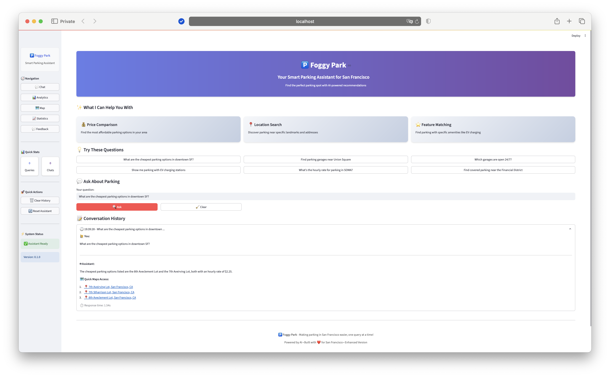

# 🅿️ Foggy Park - Smart Parking Assistant

An AI-powered parking assistant for San Francisco with advanced analytics and interactive features.


## 🚀 Quick Start

### Install Dependencies
```bash
uv sync
```

### Run weaviate in docker container
```bash
docker compose up -d
```

### Run ollama
```bash
ollama pull mxbai-embed-large
OLLAMA_HOST="0.0.0.0:11434" ollama serve
```

### Index Parking Data (Smart Indexing)
```bash
# Basic indexing (skips if no changes)
uv run python weaviate_indexer.py

# Force update (ignores change detection)
uv run python weaviate_indexer.py --force

# Verbose logging
uv run python weaviate_indexer.py --verbose
```

### Run Enhanced Application
```bash
streamlit run app.py
```

## 🎯 Features

### 💬 Smart Chat Interface
- AI-powered parking recommendations
- Interactive example questions
- Real-time response tracking
- Conversation history with export
- **🗺️ Google Maps Integration**: Click on any address to open in Google Maps

### 📊 Analytics Dashboard
- Price distribution analysis
- Feature vs. price correlations
- Most expensive/affordable parking spots
- Visual data insights

### 🗺️ Interactive Maps
- Parking location visualization
- Rate-based color coding
- Location details and directions

### 📈 Usage Statistics
- Query volume trends
- Response time analytics
- User engagement metrics

### 💬 Feedback System
- User rating collection
- Bug reports and feature requests
- Community feedback display

## 🔧 Enhanced Indexing System

### 🧠 Smart Features
- **Change Detection**: Only updates when data actually changes
- **Content Hashing**: MD5 hash comparison for efficient change detection
- **Metadata Tracking**: Stores indexing history and statistics
- **Batch Processing**: Efficient bulk document insertion
- **Comprehensive Logging**: Detailed logs with emojis for easy reading
- **Error Handling**: Robust error recovery and reporting

### 📋 Indexing Options
```bash
# Standard run (recommended)
python weaviate_indexer.py

# Force update (ignores change detection)
python weaviate_indexer.py --force

# Enable verbose logging
python weaviate_indexer.py --verbose

# Test the indexer
python test_indexer.py
```

### 📊 Generated Files
- `weaviate_indexer.log` - Detailed indexing logs
- `indexer_metadata.json` - Indexing metadata and history

## 🗺️ Google Maps Integration

### ✨ Comprehensive Address Linking
All parking responses now include clickable Google Maps links for easy navigation:

- **Automatic Link Generation**: Every parking response gets enhanced with Google Maps links
- **Smart Address Detection**: Recognizes street addresses, garage names, and area references
- **Proper URL Encoding**: Handles special characters and complex addresses perfectly
- **San Francisco Context**: All links include "San Francisco, CA" for accurate results
- **Multiple Link Formats**: Supports both HTML and Markdown link formats
- **Fallback Links**: Provides general area links when specific addresses aren't detected

### 🎯 Where You'll See Google Maps Links

**All Response Types Include Links:**
- Affordable parking recommendations with direct navigation
- Area-specific parking searches (Union Square, Financial District, etc.)
- 24/7 parking options with location access
- EV charging locations with precise directions
- Location-based recommendations via MCP service
- General parking queries with area-based links

### 🔧 Technical Implementation

**Response Enhancement System:**
- `ParkingResponseEnhancer` class processes all responses
- Integrated into `HypermodeLLM` for automatic enhancement
- Smart pattern matching for addresses and garage names
- Fallback to area-based links when specific addresses aren't found
- Uses `urllib.parse.quote_plus()` for proper URL encoding
- HTML links with `target="_blank"` for new tab opening

**Enhanced Components:**
- `parking_knowledge.py` - Direct Google Maps links in knowledge base responses
- `mcp_location_service.py` - Location-aware recommendations with navigation
- `hypermode_llm.py` - Automatic response enhancement for all API responses
- `response_enhancer.py` - Intelligent address detection and link generation
- `app.py` - Proper HTML rendering with `unsafe_allow_html=True`

### 🧪 Testing Google Maps Links

```bash
# Test Google Maps link functionality
python test_google_maps_links.py

# Test response enhancement
python -c "from response_enhancer import ParkingResponseEnhancer; enhancer = ParkingResponseEnhancer(); print(enhancer.add_maps_section('Find parking in Union Square'))"

# Test complete system
python demo_google_maps.py  # Run with: streamlit run demo_google_maps.py
```

## 🛠️ Technical Requirements

- **OLLAMA_MODELS**: 'mxbai-embed-large'
- **Python**: >=3.13
- **Weaviate**: Local instance via Docker
- **Dependencies**: See pyproject.toml

## 🏗️ Architecture

- **Frontend**: Streamlit with enhanced UI
- **Vector DB**: Weaviate for semantic search
- **Embeddings**: Ollama mxbai-embed-large
- **LLM**: Hypermode API integration
- **Data**: San Francisco parking garage information
- **Indexing**: Smart change detection system
- **Maps Integration**: Google Maps links for all addresses

## 📱 Application Versions

- **Enhanced**: Full-featured app with analytics, maps, and advanced UI

## 🎨 Enhanced Features

The enhanced version includes:
- Multi-page navigation
- Real-time analytics
- Interactive visualizations
- Advanced user interface
- Export capabilities
- Feedback system
- Usage tracking
- Smart indexing system
- **Google Maps integration for all addresses**

## 🔍 Indexing Process Flow

1. **Connection**: Establish Weaviate connection
2. **Data Loading**: Load and process parking data
3. **Change Detection**: Compare content hash with previous run
4. **Skip/Update Decision**: Skip if no changes, update if different
5. **Schema Management**: Create or verify collection schema
6. **Data Indexing**: Batch insert documents efficiently
7. **Metadata Storage**: Save indexing metadata for next run
8. **Logging**: Comprehensive logging throughout process

## 🧪 Testing Google Maps Links

```bash
# Test Google Maps link functionality
python test_google_maps_links.py
```

Built with ❤️ for San Francisco parking challenges!